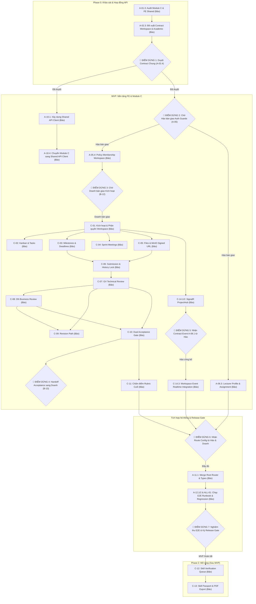

# KẾ HOẠCH HÀNH ĐỘNG CHI TIẾT DÀNH CHO THÀNH VIÊN BẢO
**Dự án:** DNTU SkillBridge  
**Workstream:** Workspace & Học thuật (Academic) + Điều phối Frontend Shared & Release  
**Căn cứ tài liệu:** Google Sheets `DNTU SkillBridge | Tasklist theo chức năng`

---

## I. TỔNG QUAN RANH GIỚI VÀ PHẠM VI TRÁCH NHIỆM

### 1. Ranh giới Frontend (FE)
*   **Workspace**: Landing, chi tiết, Kanban (`tasks`), Milestones (`timeline`), Meetings sprint, Files (`upload/download`).
*   **Học thuật & Đánh giá**: Nộp bài (`submission`), Technical review (`lecturer/evaluation`), Business review (`company/workspace`), Revision, Chấm điểm Rubric (`rubric`).
*   **Hồ sơ & Phân công**: Hồ sơ Giảng viên (`lecturer/profile`), Hàng chờ đánh giá (`assignment queue`).
*   **Portfolio (Phase 2)**: Xác minh kỹ năng (`skills/verification`), Skill Passport & Export (`student/portfolio`).
*   **Dashboard**: Dashboard Giảng viên (`lecturer/dashboard`) & Dashboard Quản trị viên (`admin/dashboard`).
*   **Hạ tầng FE dùng chung (FE Shared Lead)**:
    *   Sở hữu và duy trì thư viện gọi API chung: `src/shared/api` (Axios wrapper, error mapping, cancellation, query conventions).
    *   Sở hữu `src/shared/types` cho toàn bộ schema FE.
    *   Là **người duy nhất** merge và đăng ký route tại root router (`src/app/router/routes.tsx`).
    *   Sở hữu hạ tầng kết nối realtime SignalR client (kết nối, reconnect, snapshot, deduplication).

### 2. Ranh giới Backend (BE)
*   Các module nghiệp vụ: `Workspaces`, `ProjectTasks`, `Milestones`, `Meetings`, `Files` (MinIO/S3 signed URLs), `Submissions`, `Reviews`, `AcademicEvaluations` (Rubric scoring).
*   Hạ tầng realtime: `ProjectHub` (SignalR), group join theo workspace và phân quyền membership.
*   Dashboard/KPI queries dành cho Giảng viên và Quản trị viên.
*   Consumer xử lý hợp đồng kích hoạt Workspace (`B-12`) do Doanh bàn giao.
*   Producer phát hành sự kiện nghiệm thu kép (`C-10 Dual Acceptance Event`) bàn giao sang Doanh (để Doanh kích hoạt luồng phụ cấp SePay `B-13`).

### 3. Quy tắc cốt lõi để không đụng độ (Anti-collision Rules)
1.  **Workspace**: Chỉ tạo khi nhận được activation contract hợp lệ từ Doanh (`B-12.1`) kèm `idempotencyKey`. Không tự tạo Workspace trước hoặc sửa bảng `Commitments`/`Projects`.
2.  **Thông báo & Realtime**: Bảo sở hữu hạ tầng SignalR transport (`C-14`). Bảo **consume** interface phát thông báo `A-08.1` do Hào công bố. Không sửa bảng `Outbox`/dịch vụ `Notifications` của Hào.
3.  **Tích hợp chung**:
    *   **Bảo** là chủ sở hữu duy nhất của: `shared/api`, `shared/types`, `routes.tsx`.
    *   **Doanh** là chủ sở hữu duy nhất của: `Program.cs`, `AppDbContext`, DI composition và EF Core migrations.
    *   **Hào** chỉ làm việc trong các module: `Auth`, `Catalog`, `Notifications` và nộp config qua contract đã thỏa thuận.

---

## II. LỘ TRÌNH THỰC HIỆN VÀ CÁC ĐIỂM DỪNG (CHECKPOINTS)

---

## III. CHI TIẾT CÁC BƯỚC THỰC HIỆN TỪ ĐẦU TỚI CUỐI

### GIAI ĐOẠN 0: Khảo sát (Audit) & Hợp đồng dữ liệu (API Contract)

*   **Task A-01.3 [Phase 0 - Critical]: Audit chỉ đọc Module C & Shared FE**
    *   *Mục tiêu:* Rà soát toàn bộ route, mock/live API hiện có của Workspace, Lecturer, Submission, Review, Rubric và Shared FE (`shared/api`).
    *   *Tiêu chí xong:* Hoàn thành bảng hiện trạng các luồng `U09–U13`, chỉ rõ các endpoint còn thiếu hoặc đang mock. Tuyệt đối **không sửa code** trong bước này.
*   **Task A-02.3 [Phase 0 - Critical]: Đề xuất hợp đồng API cho Workspace & Academic**
    *   *Mục tiêu:* Thiết kế DTO, request/response, enums, error cases cho: `Workspace`, `Task`, `Milestone`, `File`, `Submission`, `Review`, `DualAcceptanceEvent`.

---

> [!CAUTION]
> ### 🛑 ĐIỂM DỪNG 1 (CHECKPOINT 1): Duyệt và Hợp nhất Hợp đồng API chung (Task A-02.4)
> *   **Phụ thuộc vào:** 
>     *   **Hào (`A-02.1`):** Hợp đồng Auth, Catalog, Notifications.
>     *   **Doanh (`A-02.2`):** Hợp đồng Projects, Applications, Teams, Commitments.
> *   **Hành động của Bảo:** Chờ Hào và Doanh nộp đầy đủ DTO/Enum của module họ. Bảo tiến hành hợp nhất vào bản OpenAPI Spec chuẩn và phát hành `src/shared/types` cho toàn bộ dự án Frontend.
> *   **Điều kiện mở khóa tiếp tục:** Cả 3 thành viên thống nhất không còn xung đột về field, kiểu dữ liệu hay endpoint URL.

---

### GIAI ĐOẠN 1: Thiết lập hạ tầng Shared FE & Nền tảng Phân quyền

*   **Task A-10.1 [MVP - High]: Xây dựng thư viện Shared API Client & Query Conventions**
    *   *Mục tiêu:* Chuẩn hóa `axios` client tại `src/shared/api`, hỗ trợ: base URL tự động (qua proxy `/api/v1`), token injection, 401 interceptor hook, query keys chuẩn cho React Query.
*   **Task A-10.4 [MVP - High]: Chuyển đổi Module C sang Shared API Client**
    *   *Mục tiêu:* Dọn dẹp các lời gọi `fetch`/`axios` cục bộ trong module Workspace/Academic, chuyển sang dùng `shared/api`.

---

> [!WARNING]
> ### 🛑 ĐIỂM DỪNG 2 (CHECKPOINT 2): Chờ Hào bàn giao Auth Guards & Helper phân quyền (Task A-05)
> *   **Phụ thuộc vào:** **Hào (`A-05.1`, `A-05.2`, `A-03.2`)** cung cấp claims định danh, helper kiểm tra quyền trên BE và Route Guards trên FE.
> *   **Lý do dừng:** Bảo không thể tự cấp quyền hay hardcode kiểm tra role tại client; cần cơ chế chuẩn từ Hào để phân quyền thành viên dự án và giảng viên.
> *   **Điều kiện mở khóa tiếp tục:** Hào bàn giao xong helper phân quyền và session state.

---

*   **Sau khi ĐIỂM DỪNG 2 mở khóa, Bảo thực hiện:**
    *   **Task A-05.4 [MVP - Critical]:** Viết BE domain policy kiểm tra membership trong Workspace, Files, Reviews và SignalR Hub.
    *   **Task A-06.3 [MVP - High]:** Xây dựng FE + API cho Hồ sơ Giảng viên (`Lecturer profile & assignment queue`).
    *   **Task A-09.2 [MVP - Medium]:** Xây dựng Dashboard Giảng viên (`lecturer/dashboard`) và Dashboard Admin (`admin/dashboard`) đọc KPI từ dữ liệu thật.

---

### GIAI ĐOẠN 2: Triển khai Không gian Dự án (Workspace Core)

---

> [!CAUTION]
> ### 🛑 ĐIỂM DỪNG 3 (CHECKPOINT 3): Chờ Doanh bàn giao Hợp đồng kích hoạt Workspace (Task B-12)
> *   **Phụ thuộc vào:** **Doanh (`B-11.3`, `B-12.1`)** hoàn thành luồng cam kết 3 bên (SV, DN, GV). Khi đủ chữ ký, Doanh phát hành payload kích hoạt gồm: `projectId`, `teamId`, `memberIds`, `lecturerId`, `activatedAt`, `idempotencyKey`.
> *   **Lý do dừng:** Theo quy tắc bất biến, Workspace **không bao giờ** được tạo trước khi cam kết hoàn tất. Bảo chỉ kích hoạt workspace dựa trên hợp đồng bàn giao từ Doanh.
> *   **Hành động của Bảo (`B-12.2`):** Kiểm tra cấu trúc payload từ Doanh, xác nhận tương thích và không thiếu field.
> *   **Điều kiện mở khóa tiếp tục:** Doanh xác nhận payload `B-12.1` hợp lệ và sẵn sàng phát hành.

---

*   **Sau khi ĐIỂM DỪNG 3 mở khóa, Bảo thực hiện đồng loạt:**
    *   **Task C-01.1 & C-01.2 [MVP - Critical]:** BE tạo Workspace theo transaction an toàn (idempotent), lưu danh sách thành viên và giảng viên hướng dẫn; chặn toàn bộ truy cập từ người ngoài.
    *   **Task C-01.3 [MVP - Critical]:** FE màn hình Workspace, xử lý các trạng thái: đang tải, chưa kích hoạt, không có quyền, đã kích hoạt.
    *   **Task C-02.1, C-02.2, C-02.3 [MVP - High]:** Hệ thống Kanban (CRUD công việc, kéo thả thẻ, phân công, ghi nhận activity log).
    *   **Task C-03.1, C-03.2 [MVP - High]:** Hệ thống Quản lý Milestone (tiến độ, deadline, quy tắc khóa mốc đã nghiệm thu).
    *   **Task C-04.1, C-04.2 [MVP - Medium]:** Hệ thống Lịch họp Sprint nội bộ trong Workspace.
    *   **Task C-05.1, C-05.2, C-05.3 [MVP - High]:** Quản lý tài liệu dự án: Upload/download thông qua MinIO/S3 Signed URL (kiểm tra MIME/size nghiêm ngặt, URL có thời hạn, dọn file mồ côi).

---

### GIAI ĐOẠN 3: Nộp sản phẩm & Đánh giá kép (Dual Review Gate)

*   **Task C-06.1, C-06.2, C-06.3 [MVP - Critical]: Quản lý Phiên bản Nộp bài (Submissions)**
    *   Sinh viên nộp phiên bản sản phẩm (Commit link, demo URL, tài liệu báo cáo).
    *   Tự động tăng `version` (v1, v2...), **khóa tuyệt đối** không cho sửa đổi phiên bản đã gửi, lưu trữ lịch sử bất biến.
*   **Task C-07.1, C-07.2 [MVP - Critical]: Thẩm định Kỹ thuật (Technical Review - GV)**
    *   Chỉ Giảng viên được phân công mới có quyền đánh giá theo 4 trụ cột kỹ thuật.
    *   Lưu điểm số, nhận xét, thời gian và định danh giảng viên.
*   **Task C-08.1, C-08.2 [MVP - Critical]: Thẩm định Nghiệp vụ (Business Review - DN)**
    *   Chỉ Doanh nghiệp sở hữu dự án mới có quyền đánh giá.
    *   **Quy tắc:** Cổng đánh giá của DN chỉ mở sau khi Giảng viên đã thẩm định kỹ thuật đạt.
*   **Task C-09.1, C-09.2 [MVP - High]: Luồng Yêu cầu Sửa đổi (Revision Workflow)**
    *   Nếu GV hoặc DN yêu cầu chỉnh sửa (`request changes`), hệ thống cho phép SV nộp phiên bản tiếp theo (`v2`) mà không làm mất lịch sử đánh giá cũ.
*   **Task C-10.1 [MVP - Critical]: Cổng Nghiệm thu kép (Dual Acceptance Gate)**
    *   Chỉ xác nhận nghiệm thu (`Accepted`) khi và chỉ khi **cả GV và DN đều đánh giá Đạt** trên cùng một phiên bản.
    *   Phát hành sự kiện nghiệm thu `DualAcceptanceEvent` kèm `milestoneId`, `submissionId` đúng **duy nhất một lần** (idempotent).

---

> [!IMPORTANT]
> ### 🛑 ĐIỂM DỪNG 4 (CHECKPOINT 4): Bàn giao Nghiệm thu kép sang Doanh (Task C-10.2 -> B-13)
> *   **Bảo phụ trách bàn giao:** Gửi payload sự kiện `DualAcceptanceEvent` sang cho Doanh.
> *   **Doanh phụ trách tiếp nhận:** Nhận sự kiện để mở khóa điều kiện thanh toán phụ cấp sinh viên qua cổng SePay (`B-13`).
> *   **Lưu ý nghiệp vụ:** Bảo không can thiệp vào bảng Payment hay trạng thái `Paid`. Trạng thái `Paid` chỉ do backend webhook của Doanh xác nhận.
> *   **Hành động:** Doanh kiểm tra nhận event và xác nhận integration pass.

---

*   **Task C-11.1, C-11.2 [MVP - High]: Chấm điểm Rubric Học thuật Cuối cùng**
    *   Sau khi vượt qua cổng nghiệm thu kép C-10, Giảng viên tiến hành chấm điểm tổng kết theo Rubric đồ án.
    *   Kiểm tra trọng số điểm hợp lệ, lưu trữ điểm số chính thức.

---

### GIAI ĐOẠN 4: Realtime Transport & Kết nối Thông báo

*   **Task C-14.1, C-14.2 [MVP - High]: Triển khai SignalR ProjectHub**
    *   Tạo hub realtime cho Workspace, kiểm tra token và membership trước khi cho join group.
    *   Xử lý phía client: tự động kết nối lại khi mất mạng, kéo snapshot API để bù đắp sự kiện thiếu, chống lặp sự kiện (`deduplication`).

---

> [!NOTE]
> ### 🛑 ĐIỂM DỪNG 5 (CHECKPOINT 5): Tích hợp Sự kiện Thông báo với Hào (Task C-14.3 -> A-08.1)
> *   **Phụ thuộc vào:** **Hào (`A-08.1`)** công bố interface/contract nhà xuất bản sự kiện (`Notification Publisher Interface`).
> *   **Hành động của Bảo:** Kết nối các sự kiện trong Workspace (task thay đổi, có bản nộp mới, có kết quả review) bắn qua port của Hào để đẩy vào Outbox/Email. Tuyệt đối Bảo không tự viết trực tiếp vào bảng Outbox của Hào.
> *   **Điều kiện mở khóa:** Hào bàn giao xong contract sự kiện `A-08.1`.

---

### GIAI ĐOẠN 5: Tích hợp Toàn diện (System Integration) & Release Gate

---

> [!CAUTION]
> ### 🛑 ĐIỂM DỪNG 6 (CHECKPOINT 6): Thu thập Cấu hình Route để Merge Root Router (Task A-11.1)
> *   **Phụ thuộc vào:**
>     *   **Hào:** Nộp danh sách route khai báo của module `Auth`, `Catalog`, `Notifications`.
>     *   **Doanh:** Nộp danh sách route khai báo của module `Student`, `Company`, `Projects`, `Applications`, `Teams`.
> *   **Trách nhiệm của Bảo:** Bảo là người duy nhất mở file `src/app/router/routes.tsx` để merge các route, kiểm tra guard phân quyền, cấu hình lazy load và trang 404 fallback.
> *   **Điều kiện mở khóa:** Cả 3 bên nộp đủ spec route, không có route nào bị trùng lặp đường dẫn.

---

*   **Sau khi hoàn tất Router, Bảo tiến hành:**
    *   **Task A-12.1 [MVP - High]:** Chuẩn bị Release Checklist, tài khoản seed 4 role, môi trường chạy E2E (sandbox email, storage, db).
    *   **Task ALL-01.1 & ALL-01.3 [MVP - Critical]:** Thiết lập kịch bản và chạy E2E cho phân hệ Workspace, Submission, Review kép và luồng sửa đổi.
    *   **Task A-12.2 [MVP - High]:** Tổng hợp lỗi smoke/regression test, phân loại lỗi và chuyển trả chính xác về cho module owner (Hào, Doanh hoặc Bảo).

---

> [!IMPORTANT]
> ### 🛑 ĐIỂM DỪNG 7 (CHECKPOINT 7): Nghiệm thu Toàn diện MVP & Ký duyệt Release Gate (ALL-01.4)
> *   **Hành động chung cả nhóm:**
>     *   Bảo điều phối chạy bộ kịch bản hoàn chỉnh **E2E-01** (từ Doanh nghiệp đăng bài -> Duyệt bài -> SV nộp đơn -> Phỏng vấn -> Ký cam kết -> Workspace -> Nộp bài -> Nghiệm thu kép).
>     *   Hào ký xác nhận (sign-off) module Auth, Catalog, Notifications.
>     *   Doanh ký xác nhận module Business, Projects và BE Composition.
>     *   Bảo ký xác nhận module Workspace, Academic và FE Shared/Router.
> *   **Điều kiện hoàn thành:** Không còn bất kỳ bug Critical/High nào tồn đọng; toàn bộ bài test Pass.

---

### GIAI ĐOẠN 6: Giai đoạn 2 (Phase 2 - Mở rộng, không chặn MVP)

*   **Task C-12.1, C-12.2 [Phase 2 - Medium]: Xác thực Kỹ năng (Skill Verification)**
    *   Hàng chờ phê duyệt minh chứng kỹ năng của sinh viên dành cho Giảng viên.
    *   Chỉ các kỹ năng được duyệt (`Verified`) mới chuyển sang trạng thái hợp lệ.
*   **Task C-13.1, C-13.2 [Phase 2 - Medium]: Skill Passport & Xuất Hồ sơ Năng lực**
    *   Tổng hợp đồ án, điểm rubric và kỹ năng đã xác thực thành hộ chiếu kỹ năng số (Skill Passport).
    *   Hỗ trợ xem trước và xuất file PDF/minh chứng cho sinh viên.

---

## IV. BẢNG MA TRẬN NHIỆM VỤ KIỂM THỬ CHÉO (TESTER ROLE CỦA BẢO)

Ngoài công việc phát triển, theo quy tắc đảm bảo chất lượng độc lập của nhóm, Bảo chịu trách nhiệm kiểm thử (Tester) cho các task của thành viên khác:

| Mã Test | Chức năng kiểm thử | Module của ai | Vai trò của Bảo | Tiêu chí đạt |
|---|---|---|---|---|
| **PROFILE-01** | Hồ sơ Sinh viên & Doanh nghiệp | Doanh | Tester độc lập | Sửa profile hợp lệ, bắt lỗi field sai, chặn user khác sửa trái phép (403). |
| **CAT-01** | Danh mục dùng chung (Active/Inactive) | Hào | Tester độc lập | Form mới chỉ chọn mục active; dữ liệu cũ vẫn đọc được theo stable ID. |
| **PROJ-01/02/03** | Wizard tạo & gửi duyệt bài toán | Doanh | Tester độc lập | Lưu draft, validate từng bước, chống gửi trùng khi double-click/mạng lag. |
| **PROJ-04** | Kiểm duyệt bài toán (Moderation) | Doanh | Tester độc lập | Admin duyệt có lý do; giảng viên không có quyền bị chặn 403. |
| **MARKET-01/02** | Tìm kiếm Marketplace & Xem chi tiết | Doanh | Tester độc lập | Lọc, phân trang, URL đồng nhất; bài đóng không cho ứng tuyển. |
| **APP-01/02/05** | Ứng tuyển cá nhân & Ứng tuyển nhóm | Doanh | Tester độc lập | Trưởng nhóm mới được gửi đơn nhóm; chặn nộp trùng; đúng hạn. |
| **APP-03/04/06** | Phỏng vấn & Tuyển chọn ứng viên | Doanh | Tester độc lập | Chỉ chủ bài toán mới được chọn; kiểm soát đúng chỉ tiêu (quota). |
| **TEAM-01** | Tạo nhóm & Mời MSSV | Doanh | Tester độc lập | Mời đúng MSSV, chặn trùng nhóm, kiểm soát số lượng thành viên tối đa. |
| **COMMIT-01** | Ký cam kết ba bên | Doanh | Tester độc lập | Đủ 3 chữ ký mới kích hoạt hợp đồng bàn giao sang Workspace. |
| **PAY-01** | Theo dõi phụ cấp & SePay | Doanh | Tester độc lập | Chỉ trạng thái từ webhook IPN mới xác nhận `Paid`, không fake trạng thái. |

---

## V. TỔNG KẾT NGUYÊN TẮC THI CÔNG DÀNH CHO BẢO

1.  **Chủ động làm việc độc lập:** Các task nội bộ của Module C (như xây dựng UI Kanban, Timeline, File service MinIO, Submission logic) có thể viết trước phần khung và mock handler cục bộ trong khi đợi contract chính thức.
2.  **Dừng đúng trạm:** Khi chạm vào các **ĐIỂM DỪNG (Checkpoint 1, 2, 3, 5, 6, 7)**, tạm dừng việc merge hoặc kích hoạt logic liên quan, gửi thông báo yêu cầu thành viên phụ trách (Hào hoặc Doanh) xác nhận hoặc bàn giao trước khi tiếp tục.
3.  **Bảo vệ file dùng chung:** Giữ nguyên tắc chỉ một mình Bảo chỉnh sửa `routes.tsx` và `shared/api` để tránh conflict code giữa các nhánh.
