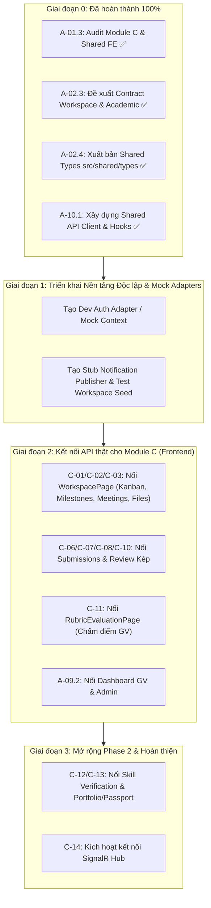

# KẾ HOẠCH HÀNH ĐỘNG CHI TIẾT DÀNH CHO THÀNH VIÊN BẢO (CẬP NHẬT)
**Dự án:** DNTU SkillBridge  
**Workstream:** Workspace & Học thuật (Academic) + Điều phối Frontend Shared & Release  
**Chiến lược thi công:** **Triển khai độc lập với Adapter / Stub Fallback (Decoupled Implementation)** — Không bị block chờ thành viên khác; tạo mock/stub ở các điểm tiếp giáp (Auth, Kích hoạt, Thông báo) để hoàn thiện 100% tính năng của mình trước, sau này chỉ việc cắm code thật vào.

---

## I. TỔNG QUAN RANH GIỚI VÀ PHẠM VI TRÁCH NHIỆM

### 1. Ranh giới Frontend (FE)
*   **Workspace**: Landing, chi tiết, Kanban (`tasks`), Milestones (`timeline`), Meetings sprint, Files (`upload/download`).
*   **Học thuật & Đánh giá**: Nộp bài (`submission`), Technical review (`lecturer/evaluation`), Business review (`company/workspace`), Revision, Chấm điểm Rubric (`rubric`).
*   **Hồ sơ & Phân công**: Hồ sơ Giảng viên (`lecturer/profile`), Hàng chờ đánh giá (`assignment queue`).
*   **Portfolio (Phase 2)**: Xác minh kỹ năng (`skills/verification`), Skill Passport & Export (`student/portfolio`).
*   **Dashboard**: Dashboard Giảng viên (`lecturer/dashboard`) & Dashboard Quản trị viên (`admin/dashboard`).
*   **Hạ tầng FE dùng chung (FE Shared Lead)**:
    *   Sở hữu thư viện gọi API chung: `src/shared/api` (Axios wrapper, error mapping, cancellation, query conventions).
    *   Sở hữu `src/shared/types` cho toàn bộ schema FE.
    *   Quản lý root router (`src/app/router/routes.tsx`).
    *   Sở hữu hạ tầng kết nối realtime SignalR client.

### 2. Ranh giới Backend (BE)
*   Các module nghiệp vụ: `Workspaces`, `ProjectTasks`, `Milestones`, `Meetings`, `Files` (MinIO/S3 signed URLs), `Submissions`, `Reviews`, `AcademicEvaluations` (Rubric scoring).
*   Hạ tầng realtime: `ProjectHub` (SignalR), group join theo workspace và phân quyền membership.
*   Dashboard/KPI queries dành cho Giảng viên và Quản trị viên.
*   Consumer xử lý hợp đồng kích hoạt Workspace (`B-12`) do Doanh bàn giao (kèm fallback stub để test).
*   Producer phát hành sự kiện nghiệm thu kép (`C-10 Dual Acceptance Event`) bàn giao sang Doanh.

---

## II. CHIẾN LƯỢC XỬ LÝ PHỤ THUỘC (DECOUPLED INTEGRATION STRATEGY)

Để không phải dừng lại chờ Hào hoặc Doanh, toàn bộ các điểm phụ thuộc được giải quyết bằng cơ chế **Adapter / Stub Layer**:

| Điểm tiếp giáp | Phụ thuộc vào ai | Cơ chế Decoupled của Bảo (Không cần chờ) | Khi người kia bàn giao code |
|---|---|---|---|
| **Auth & Phân quyền (`A-05`)** | Hào | Tạo `devAuthAdapter` / mock user context (cho phép chuyển đổi linh hoạt các role: Student, Lecturer, Company, Admin) để vào mọi trang và kiểm thử tính năng ngay. | Thay `devAuthAdapter` bằng Token JWT thật từ `tokenStorage`. |
| **Kích hoạt Workspace (`B-12`)** | Doanh | Tạo helper `seedDevWorkspace` và logic fallback trong FE (nếu ID trên URL là mock hoặc project test thì tự động nạp dữ liệu workspace hợp lệ). | Nối payload kích hoạt thật từ luồng ký cam kết `B-11`. |
| **Bắn sự kiện Outbox (`C-14.3`)** | Hào | Tạo `InMemoryNotificationPublisher` (in ra console log/activity) để các sự kiện trong Workspace hoạt động bình thường mà không bị crash. | Cắm implementation thật kết nối bảng Outbox của Hào. |
| **Thanh toán phụ cấp SePay (`B-13`)** | Doanh | Bảo hoàn thiện sự kiện `DualAcceptanceEvent` và lưu log kiểm chứng, không can thiệp bảng thanh toán. | Doanh lắng nghe event để gọi webhook SePay. |

---

## III. LỘ TRÌNH THỰC HIỆN TỪ ĐẦU TỚI CUỐI

---

## IV. CHI TIẾT TỪNG BƯỚC THI CÔNG

### BƯỚC 1: Tạo Hạ tầng Decoupled (Mock Auth & Dev Workspace Seed)
1.  **FE:** Tạo `src/shared/auth/dev-auth.ts` cung cấp thông tin tài khoản giả lập cho từng vai trò (`Student: Nguyen Van An`, `Lecturer: ThS. Tran Minh Tri`, `Company: Tech Corp`, `Admin: DNTU Admin`) và token test.
2.  **BE:** Tạo `InMemoryNotificationPublisher` kế thừa interface phát thông báo; thêm migration/seed dữ liệu mẫu cho một Workspace đầy đủ để có thể gọi thử nghiệm API.

### BƯỚC 2: Kết nối API thật cho Không gian Dự án (Workspace Core)
1.  **Màn hình Workspace (`WorkspacePage.tsx`):**
    *   Tích hợp `useWorkspaceOverview` và `useWorkspaceTeam`.
    *   Tích hợp `useKanbanBoard`: Kéo thả thẻ và đổi trạng thái qua `useMoveTask`, tạo task qua `useCreateTask`.
    *   Tích hợp `useMilestones`: Hiển thị timeline tiến độ thật, tạo và cập nhật mốc.
    *   Tích hợp `useWorkspaceMeetings`: Lên lịch họp sprint và hủy họp.
    *   Tích hợp `useWorkspaceFiles`: Tải tài liệu qua presigned URL.

### BƯỚC 3: Nộp sản phẩm & Đánh giá kép (Dual Review Gate)
1.  **Nộp bài (`StudentSubmissionPanel.tsx`):** Gọi `useCreateSubmission` với Git link, demo URL, tài liệu. Tự động khóa bản cũ khi resubmit.
2.  **Thẩm định Kỹ thuật (GV):** Màn hình đánh giá 4 trụ cột kỹ thuật gọi `useCreateTechnicalReview`.
3.  **Thẩm định Nghiệp vụ (DN):** Màn hình đánh giá nghiệp vụ của công ty gọi `useCreateBusinessReview`.
4.  **Cổng Nghiệm thu kép (`C-10`):** Kiểm tra cả 2 review đạt, phát hành `DualAcceptanceEvent`.
5.  **Chấm điểm Rubric (`RubricEvaluationPage.tsx`):** Gọi `useUpsertAcademicEvaluation` và `useFinalizeEvaluation` tính tổng điểm theo trọng số.

### BƯỚC 4: Dashboard & Phase 2 (Portfolio / Skill Passport)
1.  **Dashboard Giảng viên & Admin:** Nối KPI từ dữ liệu thật qua API Dashboard.
2.  **Xác minh kỹ năng (`SkillVerificationPage.tsx`):** Giảng viên duyệt/từ chối minh chứng kỹ năng qua `useVerifySkill` / `useRevokeSkill`.
3.  **Hộ chiếu kỹ năng (`PortfolioPage.tsx`):** Hiển thị danh sách kỹ năng đã xác thực qua `useMyVerifiedSkills`.

---

## V. TIẾN ĐỘ THỰC HIỆN
*   [x] **Giai đoạn 0:** Khảo sát, Contract API, Shared Types, API Client & Hooks.
*   [ ] **Giai đoạn 1:** Hạ tầng Decoupled (Dev Auth Adapter & Stub Publisher).
*   [ ] **Giai đoạn 2:** Kết nối API thật cho WorkspacePage, Kanban, Milestones, Meetings, Files.
*   [ ] **Giai đoạn 3:** Kết nối Submissions, Technical Review, Business Review, Rubric Final.
*   [ ] **Giai đoạn 4:** Dashboard GV/Admin, Skill Verification & Portfolio.
